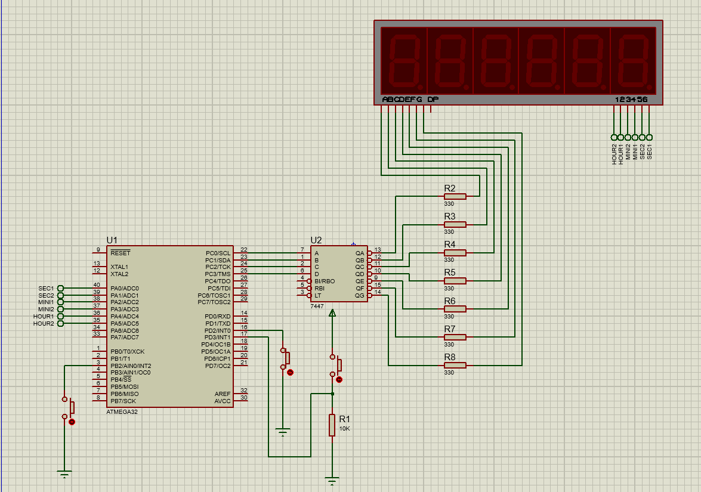

# Digital Stop Watch

A six-digit stopwatch built on the ATmega32, using multiplexed common-anode 7-segment displays, Timer1 in CTC mode, and external interrupts for reset, pause, and resume.

   

---

## Table of Contents

1. [Abstract](#1-abstract)
2. [System Requirements](#2-system-requirements)
3. [Principle of Operation](#3-principle-of-operation)
4. [Hardware Connections](#4-hardware-connections)
5. [Timer Configuration](#5-timer-configuration)
6. [External Interrupts](#6-external-interrupts)
7. [Display Multiplexing](#7-display-multiplexing)
8. [Simulation](#8-simulation)
9. [Repository Structure](#9-repository-structure)
10. [Build and Run Instructions](#10-build-and-run-instructions)
11. [Tools and Technologies](#11-tools-and-technologies)
12. [Author](#12-author)

---

## 1. Abstract

This project implements a digital stopwatch that displays seconds, minutes, and hours on six common-anode 7-segment displays. A single 7447 BCD-to-7-segment decoder drives all six displays, which are selected one at a time through NPN transistors (multiplexing technique). Time is generated by Timer1 in CTC mode, and three external interrupts provide reset, pause, and resume functions.

---

## 2. System Requirements

| # | Requirement |
|---|-------------|
| 1 | Microcontroller: ATmega32 at 1 MHz |
| 2 | Use Timer1 in CTC mode to count the stopwatch time |
| 3 | Use six common-anode 7-segment displays |
| 4 | Drive the displays using the multiplexing technique with one 7447 decoder and NPN transistors |
| 5 | Connect the 7447 inputs to the first four pins of PORTC |
| 6 | Use the first six pins of PORTA as the enable pins of the displays |
| 7 | Start counting as soon as power is connected |
| 8 | INT0 (falling edge, internal pull-up): reset the stopwatch |
| 9 | INT1 (rising edge, external pull-down): pause the stopwatch |
| 10 | INT2 (falling edge, internal pull-up): resume the stopwatch |

---

## 3. Principle of Operation

1. On power-up, Timer1 starts counting in CTC mode.
2. Each compare match raises a flag that the main loop uses to increment the seconds counter.
3. The seconds, minutes, and hours counters roll over at 60, 60, and 24 respectively.
4. The main loop continuously refreshes the six displays by enabling one digit at a time.
5. Pressing the buttons triggers external interrupts that reset, pause, or resume the count.

---

## 4. Hardware Connections

| Function | MCU Pin |
|----------|---------|
| 7447 decoder inputs (A, B, C, D) | PC0 to PC3 |
| Display enable (seconds, units) | PA0 |
| Display enable (seconds, tens) | PA1 |
| Display enable (minutes, units) | PA2 |
| Display enable (minutes, tens) | PA3 |
| Display enable (hours, units) | PA4 |
| Display enable (hours, tens) | PA5 |
| Reset button (INT0) | PD2 |
| Pause button (INT1) | PD3 |
| Resume button (INT2) | PB2 |

---

## 5. Timer Configuration

| Parameter | Value |
|-----------|-------|
| Timer | Timer1 |
| Mode | CTC (compare match with `OCR1A`) |
| Prescaler | 1024 |
| Compare value (`OCR1A`) | 1000 |
| Interrupt | Compare Match A (`TIMER1_COMPA_vect`) |

With a 1 MHz clock and a prescaler of 1024, one timer tick lasts about 1.024 ms. A compare value of 1000 therefore produces a period of approximately one second.

---

## 6. External Interrupts

| Interrupt | Trigger | Pin Configuration | Action |
|-----------|---------|-------------------|--------|
| **INT0** | Falling edge | Internal pull-up | Reset the time to 00:00:00 |
| **INT1** | Rising edge | External pull-down | Pause (stops the Timer1 clock) |
| **INT2** | Falling edge | Internal pull-up | Resume (restarts the Timer1 clock) |

---

## 7. Display Multiplexing

Only one 7-segment display is enabled at a time. The main loop selects a digit on PORTA, outputs its value in BCD on PORTC for the 7447 decoder, waits 1 ms, and moves to the next digit. Because the refresh cycle repeats quickly, persistence of vision makes all six digits appear lit simultaneously.

---

## 8. Simulation

The system was simulated in Proteus. The project file is `Stop_Watch.pdsprj`.



---

## 9. Repository Structure

```
Stop-Watch-ATmega32/
├── Stop_Watch/
│   └── project.c
├── docs/
│   └── simulation.png
├── Stop_Watch.pdsprj
└── README.md
```

---

## 10. Build and Run Instructions

1. Open the `Stop_Watch` folder as an AVR C project in Eclipse (AVR toolchain).
2. Set the clock frequency to 1 MHz and build the project to generate the `.hex` file.
3. Open `Stop_Watch.pdsprj` in Proteus.
4. Load the `.hex` file into the ATmega32 and set its clock to 1 MHz.
5. Run the simulation and use the buttons to reset, pause, and resume the stopwatch.

---

## 11. Tools and Technologies

- **Microcontroller:** ATmega32 at 1 MHz
- **Language:** Embedded C
- **IDE:** Eclipse with the AVR toolchain
- **Simulation:** Proteus
- **Concepts:** Timer1 CTC mode, external interrupts, display multiplexing, BCD decoding

---

